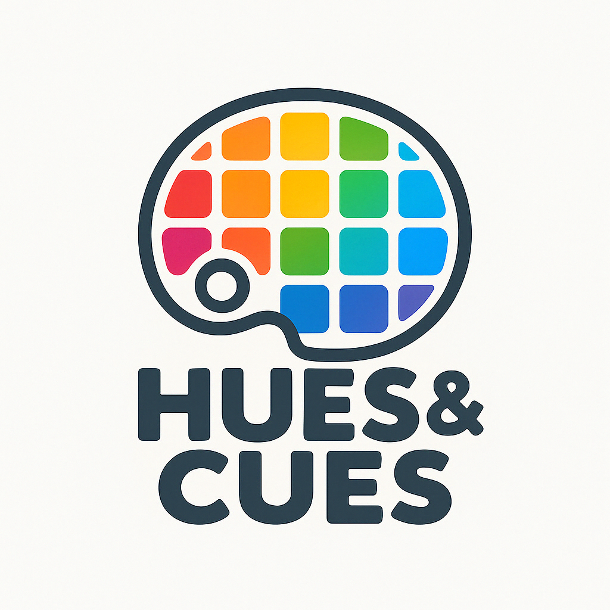

# 🎨 Hues and Cues

[](https://opensource.org/licenses/MIT)
[](https://github.com/furkankoykiran/hues-and-cues/actions/workflows/ci.yml)

> 🎮 The colorful word game in your browser!



**Play: [furkankoykiran.com.tr/hues-and-cues](https://furkankoykiran.com.tr/hues-and-cues/)**

## 📖 About

Hues and Cues is a digital adaptation of the popular color-guessing board game. Players try to guess which color on the board matches a one-word clue provided by the active player.

## 🌐 Supported Languages

Hues and Cues currently supports 2 languages:

- 🇺🇸 English
- 🇹🇷 Turkish (Türkçe)

## 🎯 How to Play

1. Form teams (1-8 teams supported)
2. The active player is shown a random color on the board and a clue word
3. The active player can hide the target color and let teammates guess
4. Teammates try to guess the correct color by clicking on the color board
5. Points are awarded based on how close the guess is to the target color
6. Teams take turns until the game ends

## ⚙️ Features

- 🎨 Light/Dark theme toggle
- 🌍 Multiple language support
- 📱 Responsive design for all devices
- 🎲 Random clue generation
- 📊 Real-time scoring

## 🚀 Getting Started

### Play Online

Visit [https://furkankoykiran.com.tr/hues-and-cues/](https://furkankoykiran.com.tr/hues-and-cues/) to play the game directly in your browser.

### Run Locally

To run the game locally:

```bash
# Clone the repository
git clone https://github.com/furkankoykiran/hues-and-cues.git

# Navigate to the project directory
cd hues-and-cues

# Open index.html in your browser
# You can use any local server or simply open the file directly
```

No build process or dependencies required! Simply open `index.html` in any modern web browser.

## 🧰 Tech Stack

- HTML5
- CSS3
- Vanilla JavaScript
- No external libraries or frameworks

## 🔍 SEO, AI discovery and checks

- Descriptive title and description, canonical URL, Open Graph and Twitter cards with a generated 1200×630 `og-image.png`.
- `WebApplication` + `Game` JSON-LD with author, licence and repository links.
- `robots.txt`, `sitemap.xml`, `llms.txt`, `ai.txt`, `.well-known/security.txt` and a web manifest in the repository root.
- `document.documentElement.lang` and `document.title` follow the language picker.
- `.nojekyll` keeps GitHub Pages from hiding `.well-known/` and other dot paths.
- `node scripts/verify-site.mjs` (also run by CI) checks the metadata, the discovery files and that every local asset referenced by `index.html` exists.

`robots.txt` is only authoritative at a host root. On
`furkankoykiran.com.tr/hues-and-cues/` the portfolio's root `robots.txt` wins; the
file here keeps the repository self-contained for standalone deployments.

## 🤝 Contributing

Contributions are welcome! Feel free to:

1. Fork the repository
2. Create a feature branch (`git checkout -b feature/amazing-feature`)
3. Commit your changes (`git commit -m 'Add some amazing feature'`)
4. Push to the branch (`git push origin feature/amazing-feature`)
5. Open a Pull Request

## 📜 License

This project is licensed under the MIT License - see the [LICENSE](LICENSE) file for details.

## 📞 Contact

Furkan Köykıran - [Website](https://furkankoykiran.com.tr)

Project Link: [https://github.com/furkankoykiran/hues-and-cues](https://github.com/furkankoykiran/hues-and-cues) 